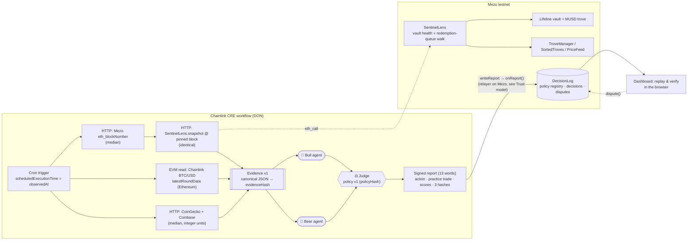

# 🛡️ Lifeline Sentinel

**An autonomous agent that can prove it took reasonable care.** A Chainlink CRE workflow watches a real, Lifeline-protected MUSD trove on Mezo testnet. A **bull** agent and a **bear** agent argue from the same evidence. A hash-registered **policy** judges between them. Every decision is written on-chain with the hash of the evidence it relied on and the hash of the rulebook it followed. Anyone can replay a decision byte-for-byte in a browser and contest it on-chain.

*BLI Legal Tech Hackathon 2 · Chainlink "Best workflow with CRE" · RYO-CHAN "Autonomous Agents" (bull/bear debate + practice trades)*

| | |
|---|---|
| Dashboard | `docs/` (GitHub Pages): live in-browser run, on-chain decision log with one-click replay, backtest of two real rescues |
| CRE workflow | [`cre/sentinel/workflow.ts`](cre/sentinel/workflow.ts): cron → HTTP + EVM capabilities → deterministic judge → signed report → `writeReport` |
| Contracts (Mezo testnet) | `SentinelLens` [`0x007d…02B5`](https://explorer.test.mezo.org/address/0x007dD5902f0B50099ce163e1E12a74275f5e02B5) · `DecisionLog` [`0x8ACF…3880`](https://explorer.test.mezo.org/address/0x8ACFA64297Cd64590ff9D18067cdb475A65a3880) |
| Position under care | Lifeline vault [`0xC92B…dbEF`](https://explorer.test.mezo.org/address/0xC92BfDC83b03d32e39930Bfb789233e1Cc0fdbEF) (from [mezo-lifeline](https://github.com/XachP/mezo-lifeline)) |
| Tests | 32 TypeScript (core + CRE SDK capability mocks + backtest) · 16 Foundry (unit, fuzz, cross-language, live-fork) |

## The legal problem: duty of care for software that manages money

When an automated system manages someone else's collateral, the questions after a loss are always the same:

1. **What did it know?** What evidence did it have when it acted, or failed to act?
2. **What rules was it following?** Were those rules fixed in advance and disclosed, or quietly changed afterwards?
3. **Was the decision reasonable given 1 and 2?** Could an independent reviewer get the same answer?
4. **Could anyone have objected?** Is there a record of the challenge?

Most "AI agent" demos can't answer any of these. Their logs are mutable, the prompt is the policy, and an LLM gives a different answer every run. Lifeline Sentinel is built so each question has a verifiable answer:

| Duty-of-care element | How Lifeline Sentinel evidences it |
|---|---|
| Informed decision | Evidence comes from independent sources: Mezo state at a block pinned by consensus, the Chainlink BTC/USD Data Feed, CoinGecko and Coinbase. It is canonicalised and hashed (`evidenceHash`), then published in full. |
| Known, prior rules | Policy v1 is canonical JSON whose keccak256 (`policyHash`) must be **registered on-chain before use**. `DecisionLog` rejects reports under any unregistered or retired policy. |
| Reasonableness, reproducibility | The agents and the judge are pure, deterministic functions: integer math, no LLM, no clock, no randomness. Same evidence plus same policy always gives the same decision and the same `reasoningHash`. The dashboard replays it in your browser. |
| Precaution over action on bad data | The judge's first rules are data-quality gates: oracle divergence, stale Chainlink round, stale snapshot, incomplete queue walk, closed trove. If any gate fails, the ruling is **ABSTAIN**. |
| Escalation | If protection is needed but no reserve is funded, the ruling is **ESCALATE** to the owner, not a silent failure. |
| Contestability | `DecisionLog.dispute(id, reasonHash, note)` lets **anyone** attach a permanent on-chain objection to any decision. |
| Tamper evidence | Monotonic `observedAt` per vault, and evidence-hash replay protection. A report can't be back-dated or re-used. |

This is a pattern, not legal advice. It shows how an autonomous agent can leave the kind of record that a court, an auditor or a client would ask for.

## Architecture



### Why each piece exists

* **SentinelLens** (`contracts/src/SentinelLens.sol`) returns the vault's full health in **one `eth_call`**: ICR, trigger and target, liquidation price, reserve, redemption-safe ICR, Recovery Mode and TCR. It also walks MUSD's sorted trove list from the riskiest end, so it returns the vault's **rank in the redemption queue and the debt ahead of it**. MUSD redemptions consume the lowest-ICR troves first, so a trove at 147% can still lose collateral to a redemption if there's too little debt ahead of it. One call means one consensus round in CRE and one pinned block, so every node sees identical bytes.
* **Pinned-block consensus.** Nodes first agree on the Mezo head (median), subtract a confirmation depth, then each runs the Lens at that exact block with `identical` aggregation. Because the judge is deterministic, identical evidence gives an identical report on every node. The DON's consensus over the inputs becomes consensus over the decision.
* **Chainlink BTC/USD** is the independent reference for Mezo's own oracle. CoinGecko and Coinbase are a second, off-chain check, and they also supply the **MUSD market price**, which drives the practice redemption-arbitrage trade.
* **DecisionLog** (`contracts/src/DecisionLog.sol`) is a CRE `IReceiver`. Its checks: forwarder-only, exact report length, registered and active policy, monotonic observation time, no evidence replay. It also has a public dispute function and an owner-managed policy registry.

## Bull vs bear vs judge

Both agents read the same evidence record. Each argument carries points and **cites the evidence fields it relies on**, and tests check that every cited field exists.

| 🐂 Bull (stay the course) | 🐻 Bear (act now) |
|---|---|
| B1 ICR headroom above the trigger | R1 below / near the trigger |
| B2 deep redemption queue (≥ 4× the buffer ahead) | R2 vault flags redemption risk / thin queue |
| B3 liquidation far away (≥ 25% BTC drop) | R3 liquidation close |
| B4 rescue reserve pre-funded | R4 Recovery Mode |
| B5 healthy system TCR | R5 no reserve |
| B6 oracles agree | R6 Mezo oracle diverges from Chainlink |
| B7 MUSD below $0.99: redemption-arb edge | R7 stale reference · R8 MUSD below peg → redemption pressure |

**Judge (policy v1), first matching rule wins:**
1. Any data-quality gate fails → **ABSTAIN**. Gates: trove active, Mezo vs Chainlink ≤ 2%, CoinGecko vs Coinbase ≤ 1.5%, Chainlink age ≤ 2 h, snapshot lag ≤ 15 min, queue walk complete.
2. The vault's own `needsProtection` flag is binding → **PROTECT** if a reserve is funded, else **ESCALATE**.
3. bear − bull ≥ 150 → **WATCH**.
4. Otherwise → **HOLD**. Confidence is 50% + 0.1% per point of margin.

**Practice trades** are recorded, never executed:
* **REDEMPTION_ARB** is a 2,000 MUSD ticket when MUSD ≤ $0.99 and the edge after an assumed 0.75% redemption fee is ≥ 25 bps.
* **HEDGE** shorts 50% of the collateral when bear − bull ≥ 300.

### Cause → effect: the two real Lifeline rescues (backtest)

On Oct 21, 2026, a Lifeline keeper ran two real rescues on this vault. `bun cli.ts --at-block N` rebuilds the sentinel's evidence as of any past block. It uses Mezo archive state, with SentinelLens injected through an `eth_call` state override because it was deployed later. The Chainlink round, the Coinbase 1-minute candle and the CoinGecko point are the ones current at that block time.

| Mezo block | Situation | Sentinel ruling | bull / bear |
|---|---|---|---|
| 16289555 | trove at 127.0%, at the front of the redemption queue | **PROTECT** (R2 redemption risk) | 200 / 719 |
| 16289556 | ⟶ Lifeline redemption-guard lift [0x2374…6e91](https://explorer.test.mezo.org/tx/0x2374b4b318d0f80c8b8ce4c5daec692d879825fdad7b26889693c1c389746e91) | | |
| 16289557 | trove at 134.1%, out of the danger zone | **HOLD** | 481 / 260 |
| 16289564 | owner raised the trigger to 140%; ICR 134.1% | **PROTECT** (R1 below trigger) | 200 / 660 |
| 16289565 | ⟶ Lifeline trigger rescue [0x1470…13ea](https://explorer.test.mezo.org/tx/0x1470fdfb0b0ce434cf104feb5dd4869af458b4e70d55fb1d97fc2e032d1413ea) | | |
| 16289566 | trove restored to 150.0% | **HOLD** | 700 / 60 |

The records are in `docs/backtest/`. Reconstructed evidence is never logged on-chain, because `DecisionLog` only accepts observations newer than the last one.

## Trust model (read this)

* **Mezo is not yet a CRE-supported chain.** The workflow reads Mezo through the **HTTP capability** as JSON-RPC, with consensus on a pinned block. It reads Chainlink through the **EVM capability** on Ethereum.
* **Writes.** The workflow produces a DON-signed report and, when a `write` target is configured, submits it with `writeReport` to a `DecisionLog` on a CRE-supported chain. On Mezo, the `DecisionLog.forwarder` slot is held by a **disclosed relayer** (`0xFeEd…c4a7`, testnet only). The relayer posts the exact report bytes the judge produced. It can't alter a decision without breaking the replay, because anyone can recompute it from the published evidence, and anyone can `dispute()` it. When CRE supports Mezo, `setForwarder(KeystoneForwarder)` removes the relayer.
* **No LLM in the decision path.** This is deliberate: replayability is the legal point. LLM output isn't reproducible across runs or nodes, so an LLM can't sit inside a consensus-signed, replayable decision. No paid API keys are used anywhere.
* **Testnet only.** Practice trades are records, not orders. The 0.75% redemption fee is an assumption written into the policy, not an on-chain value.

## Run it

```bash
# prerequisites: bun ≥ 1.2, Foundry, (optional) Chainlink CRE CLI ≥ 1.39
cd cre/sentinel && bun install

bun test                          # 32 tests: core, CRE workflow on SDK mocks, backtest
bun run typecheck
bun run compile                   # cre-compile → dist/sentinel.wasm (no account needed)
bun cli.ts                        # live: gather evidence, debate, judge, print (no tx)
bun cli.ts --replay ../../docs/evidence/<hash>.json   # recompute and check all hashes
bun cli.ts --at-block 16289555    # backtest at a past Mezo block

cd ../ && cre login && cre workflow simulate sentinel --target staging-settings   # needs a free CRE account

cd ../contracts && forge test                                  # unit + fuzz + cross-language
forge test --fork-url https://rpc.test.mezo.org                # + live-fork SentinelLens tests
```

The dashboard is static: `python3 -m http.server -d docs`, then open http://localhost:8000.

## Deployments (Mezo testnet, chain 31611)

| Step | Transaction |
|---|---|
| Deploy SentinelLens `0x007dD5902f0B50099ce163e1E12a74275f5e02B5` | [0x8ac8…2ee6](https://explorer.test.mezo.org/tx/0x8ac8ec744a1ab906bb1bf42852d53aa2360211e1038e931f07adc4aa278d2ee6) |
| Deploy DecisionLog `0x8ACFA64297Cd64590ff9D18067cdb475A65a3880` | [0x2ac7…d69b](https://explorer.test.mezo.org/tx/0x2ac7784cf7a048c0b0003c5bae80a729d025a9af12b55315a486159841ded69b) |
| Register policy v1 `0x5706…4b89` | [0xf87d…252f](https://explorer.test.mezo.org/tx/0xf87debd0f85058ff3e9575c6ddc2886c44cc69d3e397b8f230806ac7393d252f) |
| Decision #0: HOLD + practice REDEMPTION_ARB (MUSD at $0.9893), Mezo block 16291173 | [0x0573…7a90](https://explorer.test.mezo.org/tx/0x0573bd83aa1db5116963b941d27e90ba7f5b55c9a676f75463e629c4b9ca7a90) |

## How it compares

| | Tracewell | CovenantWatch | PegCheck Agent | **Lifeline Sentinel** |
|---|---|---|---|---|
| Acts on a real, deployed protocol position | – | – | – | **✔ live Lifeline vault + MUSD trove** |
| Data nobody else uses | – | SEC 8-K filings | peg price | **CDP redemption-queue rank and debt ahead** |
| Opposing agents + a judge | – | – | – | **✔ bull / bear / rule-ordered judge** |
| Policy fixed in advance and enforced on-chain | – | – | – | **✔ policy-hash registry** |
| Public, on-chain contestability | – | – | – | **✔ `dispute()`** |
| Replay a decision in the browser | hash-chained log | – | – | **✔ evidence + policy + reasoning hashes** |
| Cause → effect on real events | – | – | – | **✔ PROTECT before both real rescues, HOLD after** |

## Repository layout

```
contracts/   SentinelLens, DecisionLog, IReceiver; Foundry tests (unit, fuzz, cross-language, live fork); Deploy script
cre/         project.yaml, secrets.yaml
cre/sentinel workflow.ts + main.ts (CRE), core/ (evidence, policy, agents, judge, report), cli.ts, tests, fixtures
docs/        dashboard (GitHub Pages), policy/v1.json, evidence/ (relayed decisions), backtest/
deployments/ mezo-testnet.json
tools/       deploy.sh
```

MIT © Zachary P (XachP)
